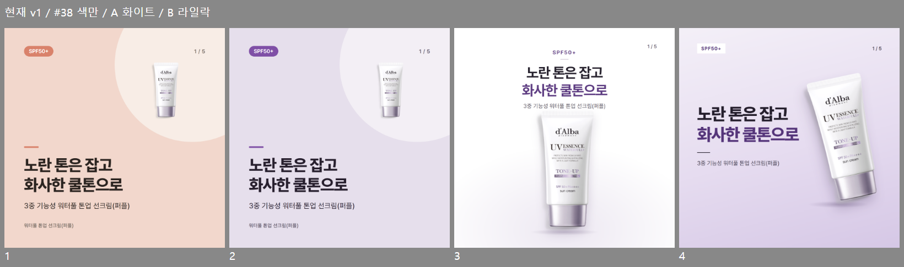

# 달바 퍼플 카드 디자인 개선 — 방향·표지 시안 (제안)

- 상태: 시안·제안. 표지는 이용석이 B 라일락 선택(2026-10-20), 구현은 이규동과 협의 전. 템플릿·공통 설정·cards.json·출력 안 바꿈
- 현재 결과 보존: `cardnews-evalinputs/products/dalba-toneup-purple/output/png` (v1, 기본 테마) 그대로
- 확인일 2026-10-20

현재 v1 / #38 색만 적용 / A 화이트 / B 라일락. 문구는 4개 모두 같음(cards.json 1번).

## 1. 지금 적용된 테마·템플릿

| 항목 | 지금 | 문제 |
|---|---|---|
| 색 | `config/theme.json` 한 벌 (살구 #D9826B, 베이지 #FBF6F1) | 제품과 무관 |
| 글꼴 | Pretendard 400·600·800 | 제목 전부 800, 위계 한 단계 |
| 표지 `cover` | 이미지 상자 380×380 오른쪽 위 고정 + 지름 760 장식 원 | 1번·5번이 같은 화면 |
| 이미지 강조 `image` | 흰 둥근 틀(모서리 36) 안에 이미지, 안쪽 여백 40 | 틀은 크고 제품은 작음 |
| 설명 `description` | 흰 둥근 상자 + 번호 원, 최대 3개 | 3·4번이 같은 목록 |
| 제품 사진 | `main.png` 500×500 중 제품 171×363. `object-fit: contain`이 투명 여백까지 맞춤 | 표지 제품 면적 3.1%, 2번 3.3% |

이미 있는 것 (중복 안 만듦):
- #38 제품 색 (`feat/38-product-color`, PR 전): 색 7개만 바꿈. 퍼플 대표 색 #BEB5C5, 주색 #7F4FA6. 출력해 보면 살구색은 없어지는데 제품 크기·둥근 상자·1·5번 반복은 그대로 → 위 비교 2번째
- 무드 시안 3종 (`docs/research/design-reference-review`): 프리미엄·더마·데일리 표지. 이번 A·B는 그중 브랜드 패키지 색 기준으로 좁힌 것

## 2. 문구로 되는 것 / 템플릿이 필요한 것

| 문제 | 문구 수정 | 템플릿·렌더 개발 |
|---|---|---|
| 표지 부제와 하단 제품명이 같은 말 | 부제를 다른 정보로 (예: 원문 "미백·주름개선·자외선차단 3중 기능성") | 하단 제품명 자리 빼기 |
| 4번 사용량이 "이마·볼·턱·코에 나눠" | 원문 그대로 "이마2, 양 볼3, 턱2, 코1" 숫자 살리기 | 숫자를 크게 보여줄 자리 |
| 2번 제목 "3중 기능성 톤업 선크림"이 표지와 겹침 | 기능 3개를 제목으로 | — |
| 살구색 테마 | — | #38 (이규동, 진행 중) |
| 제품이 작음·투명 여백 | — | 렌더 전에 투명 여백 자르기 + 표지 제품 자리 키우기 |
| 둥근 상자·번호 원 반복 | — | 설명형 새 모양 (선으로 나눈 목록, 단계형) |
| 1·5번 같은 화면 | — | 마무리 전용 모양 |
| 위계 | — | 굵기·크기 단계, 라벨 |

→ 문구만으로는 4개 중 1개 정도. 나머지는 템플릿 쪽.

## 3. 달바 브랜드에서 확인한 것 (출처)

[달바 공식몰 퍼플 상세](https://dalba.co.kr/goods/goods_view.php?goodsNo=1000000491) 상세 이미지 18장 중 6장(첫 장, 인체적용시험, TEST 01, Point 1, Point 3, SPECIAL TIP)과 상품 이미지 확인. Point 3의 시험 수치는 입력 원문에서 뺀 내용이라 참고만.

| 확인한 것 | 어디서 |
|---|---|
| 흰 바탕, 영문 세리프 제품명 크게, 위에 작은 한글 이름, 여백 많음 | 상품 페이지 상단 |
| 라일락 그라데이션 + 튜브 3개 사선 배치, 아래 한글 제품명 굵게 + 기능성 줄 + 해시태그 | 상세 1번 |
| "Point 1" 작은 라벨 → 영문 대문자 제목(SEMI MATTE TEXTURE) → 한글 설명 가운데 정렬 | 상세 Point 1 |
| 인체적용시험 항목을 라일락 원 배지 8개 + 체크 목록으로 | 상세 인체적용시험 |
| 사용법은 라일락 띠 제목 + 모델 사진 | 상세 SPECIAL TIP |
| 상품 이미지 `main_012.png` 1000×1000 (회색 배경, 투명 아님) | 상품 이미지 |

안 쓰는 것: 모델 사진·제형 스와치·시험 수치 그래프. 입력 원문·이미지에 없고, 비슷하게 만들어 넣으면 사실처럼 보임.

## 4. 제안 방향 (내 제안, 확정 아님)

- 색: 패키지의 화이트(튜브)·라일락(라벨 띠)·실버 라일락(캡). 보라 그라데이션은 바탕 한 군데만, 강조는 짙은 보라 한 색(#55357A 근처, 흰·라일락 위 대비 7 이상)
- 제품: 투명 여백 자르고 카드 면적 15% 이상 (지금 3.1%). 원본 비율·패키지 글자 그대로, 확대만
- 글자: Pretendard 유지. 제목 2줄 중 둘째 줄만 보라, 부제 500 굵기, 라벨은 작게 넓은 자간
- 장식: 둥근 상자·번호 원·장식 원 빼고 가는 선과 바닥 그림자만
- 브랜드 패턴 하나 가져옴: 장마다 작은 라벨(Point 1 → …) — 상세 페이지 구조

### 표지 2안

| | A 화이트 | B 라일락 |
|---|---|---|
| 파일 | [HTML](cover-a-white.html) · [PNG](cover-a-white.png) | [HTML](cover-b-lilac.html) · [PNG](cover-b-lilac.png) |
| 구성 | 위 가운데 글자 → 아래 제품 정면, 대칭 | 왼쪽 큰 제목 / 오른쪽 기울인 제품, 사선 |
| 제품 | 298×610px, 면적 15.6% (자른 이미지 1.6배) | 312×640px, 17.1% (1.7배) |
| 느낌 | 공식몰 상단처럼 깨끗, 제품 정보가 먼저 | 상세 1번처럼 라일락 무드, 제목이 먼저 |
| 약한 점 | 피드에서 흰 배경끼리 묻힐 수 있음 | 제목이 길면 제품과 가까워짐 (글자 수 기준 다시 재야 함) |

점검: 글자 넘침 0, 대비 최저 5.68(A 페이지 번호). 제품은 투명 여백만 자른 `product-trim.png`(183×375, 확대·변형 없음).

한계: 원본이 작아서 1.6~1.7배 확대 → 가까이 보면 살짝 흐림. 공식 `main_012.png`(1000px)를 쓰면 해결되는데 회색 배경이라 배경 제거가 필요하고, 내려받기·사용 여부 확인이 먼저.

## 5. 나머지 4장 구성 계획

같은 색·글꼴·라벨, 모양은 장마다 다르게. 문구는 원문 안에서만.

| 장 | 역할 | 모양 | 담는 것 (원문) | 문구 수정 |
|---|---|---|---|---|
| 2 | 기능성 | 라벨 "Point 1" / 제품 왼쪽 크게 + 오른쪽 기능 3개를 가는 선으로 나눈 세로 3칸 (미백 · 주름개선 · 자외선차단 SPF50+/PA++++) + 맨 아래 작은 글씨 "화장품법에 따른 기능성 화장품 심사(또는 보고)를 필함" | S3, S1 | 제목을 기능 3개 쪽으로 |
| 3 | 특징 | 라벨 "Point 2" / 상자 없이 굵은 키워드 3줄(쿨톤 보정 · 백탁 없이 · 세미 매트) + 각 아래 한 줄 설명, 가는 선으로 구분. 제품 없음 | S5, S6, S4 | 항목을 '키워드 + 설명'으로 쓸지 (데이터 규격 확인 필요) |
| 4 | 사용법 | 라벨 "How to" / 1→2 단계 가로 흐름 + 사용량 숫자 크게(이마 2 · 양 볼 3 · 턱 2 · 코 1) + 맨 아래 주의 한 줄(상처 부위 사용 자제) | S9, S10, S11 | 사용량 숫자를 원문대로 |
| 5 | 마무리 | 표지와 다른 화면: 라일락 바탕 가운데 문장 하나 + 아래 근거 줄(저자극 인체적용시험 완료 · V-LABEL 비건 인증)을 글자로만. 인증 마크 이미지 안 만듦. 제품은 작게 또는 없음 | S2, S7, S8 | 5번 "저자극" 표현은 Codex 검증 뒤 결정 |

## 6. 선택 뒤 구현 범위 (미리 보기)

| 방법 | 바뀌는 곳 | 다른 제품 영향 | 판단 |
|---|---|---|---|
| ① 기존 템플릿 3종 직접 수정 | `templates/*`, `base.css`, 글자 수 기준(`config/templates.json`) | 모든 제품 결과가 바뀜. v1 평가 기준선과 비교 불가 | 비추천 |
| ② 새 템플릿 묶음 추가 + 제품별 선택 | 새 `templates/<묶음>/`, 입력 양식에 선택 칸, `render.js` 선택 로직 | 기본은 지금 그대로라 영향 없음. 고른 제품만 바뀜 | 추천. 공통 템플릿·입력 양식이라 이규동과 협의 |
| ③ 투명 여백 자르기 | `render.js`(또는 출력 전 단계) | 모든 제품 사진이 커짐 → 글자 수·겹침 다시 측정(`npm run calibrate`) | ②와 같이. 이규동 협의 |
| ④ 설명형 '키워드 + 설명' | `docs/card-data-spec.md` items 형식 | 기존 cards.json 호환 방법 필요 | 공동 결정. 안 되면 지금 형식으로 모양만 |

v1 결과는 그대로 두고, 새 묶음 결과를 v2 후보로 비교 (규칙 버전 변경은 공동 결정).

## 확인 순서

방향·표지 확인 → 이용석 선택 → 구현 범위 확정(이규동 협의) → 5장 제작·검증 → 이용석 최종 검토 → 승인 뒤 커밋

## 7. B 라일락 선택 뒤 구현 범위 (2026-10-20 이용석 선택, 구현 전)

지금 구조 (`origin/feat/38-product-color` 4865963 기준으로 확인)
- 카드 데이터 `template`은 `cover`·`image`·`description` 3개 고정 (`schemas/cards.schema.json` enum)
- `config/templates.json`이 템플릿마다 HTML 파일 1개 + 글자 수 기준. `render`·`validate`·`calibrate`가 이걸 읽음
- 카드 HTML에 넣는 값: 문구·`page`·`total`·`product`·`image`·`imageClass`. 역할(`role`)은 안 들어감 → 표지·마무리를 다르게 못 그림
- #38 색은 `--color-*` 7개만. 대비 검사 7곳은 지금 템플릿 기준

### 방식: 기본은 그대로 두고 '디자인 묶음'을 하나 추가

| 할 일 | 바뀌는 곳 | 담당 | 다른 제품 영향 |
|---|---|---|---|
| 1. #38 병합 | — | 이규동 | 선행 조건. B 색은 #38 색 7개로 만듦(라일락 = `bg`→`accent`, 강조 = `primary`) |
| 2. 퍼플 문구 수정 (부제 중복, 2번 제목, 4번 사용량 숫자) | `products/dalba-toneup-purple/cards.json` | 이용석 · Claude Code (수정 작업) | 없음 |
| 3. 5장 정지 시안 (B 스타일, 4장 모양 확정) | `docs/research/dalba-purple-redesign/` | 이용석 · Claude Code | 없음. 템플릿 만들 때 기준 화면 |
| 4. 디자인 묶음 선택 | 입력 양식 `## 디자인`(예: `기본` · `라일락 에디토리얼`), `config/templates.json`에 묶음별 파일·글자 수, `render.js`·`validate.js`가 묶음 기준으로 읽기 | 이규동 협의 (공통 입력 양식·설정) | 안 고르면 지금과 같음 |
| 5. 새 템플릿 3개 | `templates/<묶음>/cover·image·description.html` | 이규동 협의 (구현은 이규동 또는 이용석 쪽 Codex) | 없음 (새 폴더) |
| 6. 역할 값 넘기기 | `scripts/lib/card-html.js` 값에 `role` 추가 1줄 → 같은 템플릿에서 표지/마무리, 특징/사용법 모양 나눔 | 이규동 협의 | 기존 템플릿은 `{{role}}`을 안 써서 영향 없음 |
| 7. 투명 여백 자르기 | 출력 때 제품 사진 불투명 영역 계산(#38이 이미 픽셀 읽음) → 새 템플릿에만 `object-view-box`로 적용 | 이규동 협의 | 새 묶음에만. 기본 템플릿 제품 크기는 그대로 |
| 8. 글자 수 기준·대비 | `npm run calibrate`로 새 템플릿 기준 측정. 대비는 #38 7곳 안에서 맞춤(뱃지는 보라 바탕 흰 글자 = `on-primary/primary`) | 이규동 협의 | 없음 |
| 9. 테스트 | 묶음 선택·기본값 유지·역할별 모양·여백 자르기 | 구현한 쪽 + 반대 도구 검토 | — |
| 10. 퍼플 5장 출력·검증 → 이용석 최종 검토 | `npm run render`, `validate` | 이용석 · Claude Code | — |

안 바꾸는 것: 기존 템플릿 3개·`base.css`·`theme.json`·카드 데이터 규격(`template` 값 3개 그대로)·`CLAUDE.md`·Skill·규칙 버전. v1 결과는 그대로 남아 비교 가능

같이 정할 것
- 디자인 묶음을 입력 양식 칸으로 고를지, 무드 판단(#39)이 고르게 할지 (처음엔 사람이 고르는 쪽 추천)
- 묶음 이름·개수 (일단 1개로 시작)
- 규칙 버전: 색처럼 문구 규칙과 별개로 볼지 (#38은 안 올림)
- 3번 특징 '키워드 + 설명' 나누기는 데이터 규격 변경이라 이번엔 빼고 지금 항목 형식 그대로
- 일정: 10.28 시연 전에 넣을지, 시연 뒤로 할지

## 8. B2 라일락 5장 시안 (2026-10-20, 내부)

공식 사진 2장(상품 이미지 `main_012.png` 1000px 투명 누끼, 상세 첫 장 연출 사진)을 써서 저장소에는 안 넣음. 이용석 PC 임시 폴더에만 있음. 멘토 확인 전 공개 안 함.

| 장 | 사진 | 모양 | 문구 |
|---|---|---|---|
| 1 표지 | 연출 사진 (상세 첫 장, 글자 부분 잘라냄) | 사진 오른쪽 높이 맞춤, 왼쪽 위 빈 곳에 제목 | cards.json 그대로 |
| 2 기능성 | 고해상도 제품 | 왼쪽 제품 크게 / 오른쪽 기능 3칸 + 근거 각주 | 제목 "3중 기능성"으로 줄임, 칸·각주는 원문 S3 |
| 3 특징 | 고해상도 제품 | 선으로 나눈 3줄 + 오른쪽 라일락 띠에 제품 | 그대로 |
| 4 사용법 | 고해상도 제품 | 단계 2개 + 사용량 숫자(이마 2·양 볼 3·턱 2·코 1) + 주의 한 줄 | 사용량 숫자는 원문 S10 그대로 살림 |
| 5 마무리 | 연출 사진 아래쪽 | 위 라일락 + 가운데 문장 + 근거 글자 | 그대로 ("저자극" 표현은 검증 대기) |

점검: 글자 넘침 0, 대비 최저 5.96, 사진 확대 최대 1.2배(5번 연출 사진), 제품 사진은 1.1배 이하

자동화로 가려면 추가로 필요한 것 (7장 표에 더해)
- 입력 이미지 용도 구분: `제품 단독`·`연출` (지금 이미지 칸 설명에 적는 걸 값으로). 연출 사진이 없으면 1·5번은 고해상도 제품 + 라일락 바탕으로
- 연출 사진 위 글자 자리: 사진의 빈 곳을 자동으로 찾거나(픽셀 밝기 고른 영역), 안전하게 위쪽 띠 + 가림막 그라데이션
- 2번 기능 칸·4번 사용량 숫자는 지금 문구 1~2줄로는 못 그림 → 항목(`items`)을 쓰는 이미지형, 사용량은 원문 숫자를 그대로 쓰는 항목 형식이 필요 (데이터 규격 공동 결정)
- 줄바꿈: 3번 1항목처럼 마지막 단어만 다음 줄로 가는 경우 → 글자 수 기준을 새 템플릿으로 다시 재기
