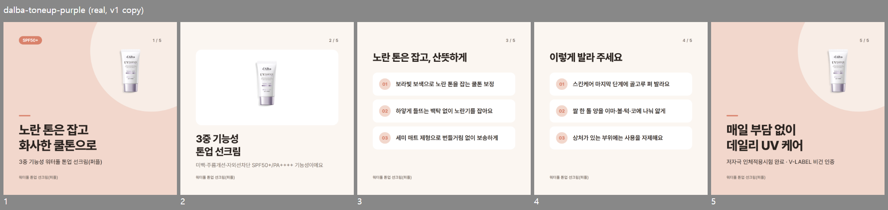
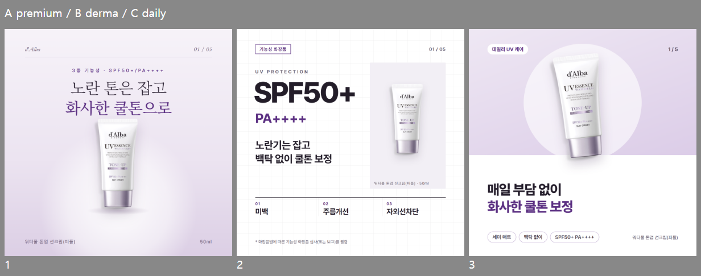

# 카드뉴스 디자인 레퍼런스 분석 · 무드 기반 자동화 제안

- 상태: **분석·제안** (2026-10-20, 이용석). 규칙·템플릿·코드·규칙 버전은 안 바꿈. 아래 방향은 승인된 결정이 아님
- 관련: [글 무드·제품 색 무드 제안](../proposals/mood-proposal.md) (#39), 제품 색 + 대비 검사 (#38, 이규동 구현 중)
- 시안 파일: [design-reference-review/](design-reference-review/) — 표지 시안 3개(HTML·PNG), 현재 v1 출력 묶음
- 퍼플 후속: [dalba-purple-redesign](dalba-purple-redesign/README.md) — 표지 A·B 비교, B 라일락 선택 뒤 구현 범위 (제안)

## 0. 확인 범위와 한계

| 자료 | 확인한 것 | 확인일 | 한계 |
|---|---|---|---|
| 저장소 `origin/main` 54465ed | `CLAUDE.md`·`AGENTS.md`·`docs/style-guide.md`·`docs/proposals/mood-proposal.md`·`config/theme.json`·`config/templates.json`·`templates/*`·두 Skill | 2026-10-20 | — |
| 실제 제작물 | `dalba-toneup-purple` v1 (copy 단계, 5장 PNG + 출력 HTML 측정) | 2026-10-20 | 로컬 출력(`output/`은 git 제외). 사람 최종 승인 전 |
| 설명용 예시 | `toneup-sunscreen-r1` (가상 브랜드, 배포 데이터 `kind: example`) | 2026-10-20 | 실제 제품 아님. 비교용으로만 봄 |
| 노션·Figma V2(68:403) | 같은 날 앞선 작업에서 확인한 내용 기준 | 2026-10-20 | 이번에 다시 열지 않음. 바뀐 내용 있으면 반영 안 됨 |
| 서비스 4곳 | 공식 페이지·사용 가이드·공개 예시 화면 (아래 2장) | 2026-10-20 | 로그인·결제·약관 동의가 필요한 실제 생성·편집 화면은 안 봄 |

## 1. 현재 출력물의 문제와 근거

실제 제작물(퍼플 v1)과 가상 예시(r1)를 나란히 봤다. 측정값은 출력 HTML을 1080px로 열어 잰 값.



| 문제 | 근거 (퍼플 v1) |
|---|---|
| 제품이 너무 작음 | 표지 제품이 보이는 크기 130×276px, 카드 면적의 **3.1%**. 2번 이미지 강조형도 흰 틀(888×473)은 크지만 제품은 134×285px(3.3%). 원본 누끼컷이 500×500에 제품 171×363px라 키울 여지도 적음 |
| 제품 색과 카드 색이 따로 놂 | 보라 제품인데 배경은 `theme.json` 살구·베이지(#F2D7CC·#FBF6F1). #38이 해결 중 |
| 제품이 달라도 같은 카드 | 가상 예시 r1(핑크 튜브)과 퍼플 v1이 색·배치·글자 크기까지 같음. 템플릿 3종·색 한 벌·글꼴 한 벌(Pretendard) 고정 |
| 1번과 5번이 같은 화면 | 둘 다 `cover` 템플릿 + 같은 제품컷 + 같은 장식 원. 마무리 카드가 표지 반복처럼 보임 |
| 설명 카드가 목록뿐 | 3·4번: 목록이 y 316~796, 아래 160px(15%)가 빔. 항목은 모두 한 줄인데 상자는 2줄 높이. 시각 요소 없이 흰 상자 3개 |
| 위계가 한 가지 | 모든 제목 800 굵기(64~80px), 본문 34~38px. 표지 부제가 하단 제품명과 같은 내용(“워터풀 톤업 선크림(퍼플)”) 반복 |
| 핵심 수치가 작음 | SPF50+/PA++++가 표지 뱃지(26px)와 2번 캡션(34px, 보조 글자색)에만. 선케어에서 가장 강한 정보가 가장 작음 |

잘 된 점: 넘침 0, 원문 근거 연결, 글자 대비는 기본 테마에서 문제 없음. 내용 규칙은 지키되 **보이는 방식**이 제품을 못 따라가는 상태.

## 2. 서비스 비교

표기: **확인** = 이번에 화면·가이드에서 직접 봄 / **홍보** = 서비스가 스스로 하는 말(검증 안 됨) / **미확인** = 못 봄

| | 망고보드 AI 카드뉴스 | aiCarousels | Anglevo (Article to Carousel) | 카드브리핑 |
|---|---|---|---|---|
| 본 자료 | 소개 페이지, 사용 가이드(최종 수정 2026-10-15, 화면 캡처 포함) | 소개 페이지 예시 캐러셀, 사용 가이드 | 도구 페이지 3단계 설명·FAQ | 소개 페이지, 편집 화면 녹화(소개 페이지 LIVE), FAQ |
| 흐름 | **확인**: 주제(+첨부 TXT·PDF·JPG·PNG) → 디자인 계획 요약 4줄 → “총 7 슬라이드 개요” 확인·직접 수정 → “이 내용대로 진행” → 표지 썸네일 + 더 보기 → 에디터 편집 또는 다운로드 | **확인(가이드)**: 주제·텍스트·웹사이트·유튜브·PDF로 문구 생성 → 템플릿 고르거나 무작위 → 카드별 설정 → 다운로드 | **확인(설명)**: 출처 URL·긴 글 → 근거 기반 “각도(angle)” 여러 개 비교·선택 → 슬라이드 편집 → PNG ZIP | **확인**: 업종 고르고 추천 주제 → 주제 한 줄 → “AI가 기획하기” → 썸네일 줄 + 캔버스 + 오른쪽 도구(배경·스타일·폰트·강조색…) |
| 무드 파악 자료 | **확인**: 첨부 이미지는 글자 읽기용, 이미지 스타일에는 반영 안 된다고 가이드에 명시. 디자인 방향을 고르는 단계는 가이드에 없음 | **확인(가이드)**: 사람이 템플릿·팔레트·글꼴을 고름. 브랜드 탭에 로고·이름 | **미확인** (디자인 방향 단계 설명 없음) | **홍보**: 주제 독자에 맞춰 카피 앵글을 매번 다르게(기업→리포트·ROI, 가게→혜택·후기). 디자인 무드 판단 근거는 미확인 |
| 사람이 방향을 고르는 때 | 개요(내용) 확인 때. 디자인은 생성 후 에디터에서 | 생성 후 템플릿·설정에서 | **생성 전** 각도 선택 (내용 방향) | 생성 후 편집 |
| 표지 | **확인**(가이드 예시): 사진이 카드 위 약 2/3를 꽉 채우고, 아래 색 띠에 작은 머리말 1줄 + 굵은 흰 제목 2줄, 원·별·사선 장식 | **확인**(예시): 작은 머리말 → 세로로 좁은 굵은 제목 3줄, 핵심 단어만 다른 색, 인물 일러스트, ‘Swipe’ 버튼 | 미확인 | **확인**(녹화): 사진 배경 전체 + 어두운 덮개, 작은 역할 라벨(INSIGHT·CHECKLIST) → 큰 제목(한 단어만 강조색) → 부제 1줄 |
| 위계 | 머리말 < 제목 2단, 장식 많음 | 머리말 / 제목(2색) / 본문 3단, 제목 글꼴이 본문과 다름 | 미확인 | 역할 라벨 / 제목 / 부제 3단, 가운데 정렬 |
| 사진 | 사진 전면(배경형) | 표지·마무리는 배경 사진 흐리게, 본문은 글/글+이미지/이미지/스크린샷 4모드, 채움·전체 보기 선택 | 미확인 | AI 배경을 장마다 새로 생성(**홍보**), 배경 라이브러리 패널 **확인** |
| 한 세트의 통일감 | 미확인(썸네일 1장만 봄) | **확인**: 본문 카드 경계를 넘어 이어지는 반원 장식, 같은 번호 원, ‘Alternate Color’로 장마다 색 번갈아(가이드) | 미확인 | 장마다 배경은 다르고 라벨·글꼴은 같음(녹화) |
| 긴 글 | 개요 단계에서 장 수·내용 조절 | **확인(가이드)**: 표지·마무리 글자 자동 크기, 문구 줄이기·쉽게 쓰기 AI 도우미 | 미확인 | 한 장만 다시 쓰기(요금표에 별도 항목) |
| 근거·주의 표현 | 미확인. 첨부 내용이 다 반영되지 않을 수 있다고 가이드에 명시 | 없음(확인 범위 안) | **홍보**: 각도는 청중·서사·“출처의 뒷받침 근거”를 우선해 점수. 카드 문구와 원문 인용을 잇는 화면은 **미확인** | 없음(확인 범위 안). AI가 글자를 이미지에 굽지 않고 글자로 얹는다고 FAQ에 명시 |
| 링크 | [소개](https://www.mangoboard.net/AIDesigner/Cardnews) · [가이드](https://www.mangoboard.net/guide/559) | [소개](https://www.aicarousels.com/) · [가이드](https://www.aicarousels.com/blog/how-to-use-aicarousels) | [도구](https://www.anglevo.com/tools/article-to-carousel) | [소개](https://cardbriefing.com/) |

못 본 것: 네 곳 모두 실제 생성 결과를 내 입력으로 만들어 보지 않음(망고보드·카드브리핑은 로그인·포인트, aiCarousels는 ‘생성’을 누르면 약관 동의로 간주된다고 적혀 있어 안 누름, Anglevo는 결과 화면이 입력 후에만 나옴). Anglevo 페이지는 브라우저 자동 번역 상태로 읽음.

### 우리 프로젝트와 비교

| 질문 | 서비스 4곳 | 우리 (v1) |
|---|---|---|
| 무드를 무엇으로 | 사람이 템플릿 선택(aiCarousels), 업종·주제(카드브리핑). 원문·제품 사진으로 무드를 정하는 곳은 확인 못 함 | 없음. 테마 한 벌 고정 |
| 사람 확인 시점 | 내용 개요(망고보드)·각도(Anglevo)는 생성 전, 디자인은 대부분 생성 후 편집 | 구성안 승인(내용)만. 디자인은 확인 시점이 없음 |
| 근거 검토 | 근거를 내세우는 곳은 Anglevo뿐(각도 선택 단계) | 문구별 `sources` 인용 + 검증 + [주의] — **4곳보다 강함** |
| 편집 | 4곳 모두 자유 편집기(글자·색·이미지 직접) | 편집기 없음. 수정 요청 → 재생성 (원문 규칙을 지키려는 선택) |

## 3. 가져올 것 (추천)

| 요소 | 어디서 | 왜 | 우리 식으로 |
|---|---|---|---|
| 생성 전에 **방향 후보를 비교·선택** | Anglevo(내용 각도), 망고보드(개요 확인) | 지금은 디자인을 다 만든 뒤에야 보임. 방향이 틀리면 5장 다 다시 | 구성안 승인 때 **무드 1개 + 근거 문장 + 표지 시안 3개**를 같이 보여주고 고름 |
| **역할 라벨**(INSIGHT·CHECKLIST) | 카드브리핑 | 카드마다 역할이 한눈에 보여서 세트의 흐름이 생김 | `role`(cover·feature·usage·closing)을 작은 라벨로. 무드별 문구(“Point”·“How to”·“사용법”) |
| **제목 한 단어만 강조색** | aiCarousels, 카드브리핑 | 색을 넓게 쓰지 않고도 제품 색이 보이고 위계가 생김 | 제목 2줄째 또는 핵심 단어만 `primary`. 대비 검사는 #38 그대로 |
| **카드 경계를 넘는 장식 / 장마다 색 번갈아** | aiCarousels | 넘겨 볼 때 한 세트로 읽힘 | 무드 프리셋의 선택 항목으로 (장식 하나만) |
| **본문 카드 모드 나누기**(글/글+이미지/이미지) | aiCarousels | 설명 카드가 목록만이라 빈 공간이 생김 | 설명형에 “수치 강조” 모드(SPF·%·기간을 크게)와 “제형·텍스처 이미지” 자리 |
| **글자는 이미지에 굽지 않음** | 카드브리핑 FAQ | 한글 획이 뭉개지고 수정·검증이 안 됨 | 이미 그렇게 함(HTML 글자). 배경 이미지를 쓰더라도 유지 |
| 가져오지 않을 것 | — | — | 자유 편집기(원문 근거 관리가 깨짐), 장마다 AI 배경 새로 생성(제품 사실과 무관한 장면·일관성 문제), 과한 장식(망고보드 예시의 별·사선) |

## 4. 무드 기반 자동화 설계안

### 흐름

```
입력: 원문(input.md) · 제품 사진 · (선택) 브랜드 참고 캡션·이미지
  → ① 판단: 제품 유형 / 브랜드 무드(근거 문장) / 색 팔레트(사진)
  → ② 구성안 + 무드 1개 + 표지 시안 3개 (무드 방향 3개를 같은 사실로)
  → ③ 사람: 구성안 승인 + 표지 1개 선택 (또는 무드 바꿈)
  → ④ 선택한 방향으로 5장 문구·출력
  → ⑤ 검증: 원문 근거·[주의]·글자 수·넘침·대비·제품 크기
  → ⑥ 사람 최종 검토
```

### 세 축을 따로 판단

| 축 | 정하는 것 | 입력 | 대표 색 하나로 정하지 않는 이유 |
|---|---|---|---|
| 제품 유형 | 꼭 넣을 정보·카드 구성 (선케어: SPF/PA·사용량) | 입력 양식 ‘카테고리’ | — |
| 브랜드 무드 | 말투·글꼴·여백·사진 비중 | 원문 말투·주장 종류 + 참고 캡션 | 같은 보라 튜브라도 원문이 “선사합니다”면 프리미엄, 수치·시험이 많으면 더마 |
| 색 팔레트 | 배경·강조색 | 제품 사진(#38) | 무드가 아니라 **색 값만** 정함. 무드가 색을 쓰는 방식(옅은 단색 / 흰 바탕+포인트 / 색 블록)을 정함 |

### 디자인 방향 3개 (기존 제안서와 이름 맞춤)

기존 [글 무드 제안](../proposals/mood-proposal.md)의 첫 3개(프리미엄 / 더마·전문 / 내추럴·순한)에 디자인을 붙인 것. 앞서 정리한 시각 무드 5종(프리미엄·더마·비건클린·데일리·선케어)에서 **선케어는 무드가 아니라 제품 유형**이라 뺐고, 비건클린은 인증 근거가 있을 때 나중에 추가, 데일리는 내추럴·순한과 합침.

| | A. 프리미엄 에디토리얼 | B. 더마·팩트 | C. 내추럴·데일리 |
|---|---|---|---|
| 어울리는 자료 | 합니다체·감각 형용사(“선사합니다”, “완성합니다”), 원료 산지·고급 원료 | 기능성 심사·인체적용시험·수치(SPF, %, 기간)가 많음 | 해요체, “매일·부담 없이·순한·가볍게”, 사용감 중심 |
| 문체·제목 | 명사형·짧게, 감각어 1개. 제목 2줄 대구 | 사실 먼저, 수치를 제목 위로. 근거는 각주로 원문 그대로 | 부드러운 해요체, 생활 장면 한 줄 |
| 글자 | 세리프 제목(가늘게 300 / 강조 500), 영문 이탤릭 보조, 자간 넓은 작은 머리말 | 산세리프 굵게, 숫자 가장 크게(130~170px), 라벨은 대문자·넓은 자간 | 산세리프 800 크게, 2줄째만 강조색, 칩(키워드) |
| 여백 | 많이. 글자는 위 1/3, 장식은 가는 선 1개 | 격자에 맞춤. 표·구분선으로 나눔 | 색 블록 / 흰 영역 2단 |
| 색·대비 | 제품 색의 옅은 단색 그라데이션, 강조는 짙은 같은 색 | 흰 바탕 + 제품 색 한 가지(선·숫자 일부) | 제품 색 파스텔 블록 + 흰색, 강조는 짙은 같은 색 |
| 제품 사진 | 가운데 크게(카드 면적 7~10%), 바닥 그림자 | 오른쪽 패널에 중간 크기(4~6%), 정면 | 가장 크게(10~15%), 살짝 기울여 블록 경계를 넘김 |
| 카드 역할별 | 표지 가운데 정렬 → 특징: 큰 제품 + 한 줄 → 설명: 번호 이탤릭 + 가는 선 목록 → 마무리: 제품 없이 문장 하나 | 표지 수치 → 특징: 수치·시험 표 → 설명: 2열 표 → 사용법: 단계 번호 + 사용량 수치 → 마무리: 근거 각주 모음 | 표지 큰 제품 → 특징: 제형·사용감 → 설명: 칩·아이콘 자리 → 사용법: 단계 → 마무리: 데일리 장면 한 줄 |
| 피할 것 | 금색·대리석 같은 과한 소품, 원문에 없는 ‘럭셔리’ 류 단어 | 원문에 없는 시험·수치·“피부과”, 의약품처럼 보이는 십자·알약 아이콘 | 이모지·느낌표, 원문 없는 ‘순한’·‘저자극’, 캐릭터 장식 |
| 자동 판단이 애매할 때 | 사람이 V2 구성안 화면에서 무드를 바꾸면 표지 3개 중 그 방향으로 다시 출력 (수정 유형 `DESIGN`) | 같음 | 같음 |

### 무드 고르는 방법 (브랜드별 학습 없이)

1. 원문 신호를 센다 (모두 원문 인용으로 남김)
   - 말투: 문장 끝 ‘합니다’ vs ‘해요’, 감각 형용사
   - 주장 종류: 기능성·시험·수치 문장 수 / 원료 산지·고급 원료 / 사용감·일상 표현
   - (선택) 브랜드 참고 캡션 1~3개 — 있으면 원문보다 먼저
2. 가장 많은 쪽을 고르고, 1·2위 차이가 작으면 **애매함**으로 표시해 사람에게 표지 3개를 다 보여줌
3. 사진은 색 값만(#38). 사진으로 무드를 정하지 않음
4. 판단 결과는 `cards.json`에 안 넣고 결과 보고에만 남기는 것부터 시작 → 쓸 만하면 `analysis.mood` 같은 필드를 공동으로 정함

달바 퍼플에 적용해 보면: “선사합니다·완성합니다”·이탈리아산 화이트 트러플(프리미엄) / 기능성 심사·인체적용시험 4개·SPF50+/PA++++(더마) / “매일 부담 없이 … 데일리 UV 케어”(데일리)가 다 있어서 **애매함**. 이런 제품이 표지 3개 비교가 가장 필요한 경우.

## 5. 달바 퍼플 표지 시안 3개

같은 사실(원문 `input.md`, 현재 `cards.json`)만 썼다. 색은 #38 시제품의 퍼플 계산값(대표 #8C7E97, primary #7E50A5)에서 대비를 맞춰 더 짙게 씀.



| | A. 프리미엄 | B. 더마·팩트 | C. 내추럴·데일리 |
|---|---|---|---|
| 파일 | [HTML](design-reference-review/cover-a-premium.html) · [PNG](design-reference-review/cover-a-premium.png) | [HTML](design-reference-review/cover-b-derma.html) · [PNG](design-reference-review/cover-b-derma.png) | [HTML](design-reference-review/cover-c-daily.html) · [PNG](design-reference-review/cover-c-daily.png) |
| 제목 | 노란 톤은 잡고 / 화사한 쿨톤으로 (v1 그대로) | 노란기는 잡고 / 백탁 없이 쿨톤 보정 | 매일 부담 없이 / 화사한 쿨톤 보정 |
| 원문 근거 | “보라빛으로 노란 톤은 잡고 화사하게 쿨톤 보정” | “하얗게 들뜨는 백탁 현상 없이 노란기를 잡아주는 쿨톤 보정 효과”, 기능성 심사 문장(각주) | “매일 부담 없이 사용할 수 있는 데일리 UV 케어”, “세미 매트 제형” |
| 제품 크기 | 205×436px, 면적 7.7% (원본 1.2배 확대) | 161×341px, 4.7% (0.94배) | 259×550px, 12.2% (1.5배) |
| 고른 이유 | 원문 말투가 합니다체·감각어. 제품을 주인공으로, 글자는 적게 | 선케어라 수치가 가장 강한 정보. 기능성 3개를 표로 | 데일리 사용 강조, 넘겨 보는 첫 장에서 제품이 가장 먼저 보임 |
| 5장으로 넓힐 때 | 같은 그라데이션·세리프, 카드마다 제품 크기만 바꿈(표지 크게 → 특징 중간 → 마무리 없음) | 격자·표를 끝까지, 3번 설명을 2열 표로, 4번 사용량(쌀 한 톨·부위별 개수)을 숫자로 | 색 블록 높이를 장마다 달리(60% → 30% → 띠), 칩을 각 장 키워드로 |

점검(시안 출력 스크립트, 저장소 밖): 글자 넘침 0, 글자 상자끼리 겹침 0, 글자 대비 최저 5.22(A 하단 22px) — 모두 4.5 이상. 글꼴은 Pretendard(저장소) + 이 PC의 Noto Serif KR·Garamond라 다른 컴퓨터에선 세리프가 대체 글꼴로 보일 수 있음.

한계:
- 원본 누끼컷이 500×500(제품 171×363px)이라 C는 1.5배 확대로 살짝 흐림. 제품을 크게 쓰려면 **긴 변 1000px 이상** 누끼컷이 필요 → 입력 양식 안내 후보(공동)
- `main.png` 사용 가능 여부가 입력에 ‘확인 중’. 내부 시안용으로만 씀
- 표지만 만듦. 2~5번은 위 ‘5장으로 넓힐 때’ 규칙만 적음

## 6. 담당

| 이용석 | 이규동과 협의 |
|---|---|
| 무드 판단 기준(원문 신호 목록·애매함 기준) | 무드별 디자인 프리셋 구현 방식(템플릿 파일을 나눌지, CSS 변수·클래스로 할지) |
| 무드별 문체·제목 규칙, 카드 역할 라벨 문구 | 공통 템플릿·`base.css`·렌더러 변경 |
| 레퍼런스 분석, 시안 평가 기준(아래 7장 체크리스트) | #38 색 계산·대비 검사와 무드 프리셋 연결(옅은 단색 / 흰+포인트 / 블록) |
| V2 구성안·근거 화면에서 무드·근거·표지 3개를 보여주는 방식(화면 설계) | 입력 양식: ‘브랜드 톤 참고’ 칸, 누끼컷 해상도 안내 (공통 입력 양식) |
| | 데이터 규격: `analysis.mood`·표지 선택 기록을 둘지 (공통 데이터 규격) |
| | 제품 크기 점검(면적 %)을 레이아웃 점검에 넣을지 |

경계: 원문 근거·과장 방지 규칙은 무드보다 위. 문구별 근거 관계는 기존 `sources`만 쓰고 새로 만들지 않음. 배포 사이트 V2는 보기 전용 그대로(선택·수정은 로컬 웹 제작 화면).

## 7. 작은 단위 우선순위와 검증

| 순서 | 할 일 | 누가 | 검증 |
|---|---|---|---|
| 1 | 이 문서·시안 리뷰, 방향 3개 이름·범위 합의 | 공동 | 주간 회의에서 결정 기록 |
| 2 | 원문 신호표로 무드 판단을 평가 입력 5개에 손으로 해 보기 | 이용석 | 사람 2명이 각자 판단 → 일치율. 애매함이 몇 개인지 |
| 3 | 무드별 문체·제목 규칙 초안(style-guide 후보, 아직 반영 안 함) | 이용석 | 같은 원문을 3무드로 쓴 예 → [주의]·근거 오류가 늘지 않는지 validate |
| 4 | 표지 프리셋 3개를 템플릿으로 (기존 `cover`는 그대로 두고 옆에) | 이규동 | `npm run calibrate`로 글자 수 기준, 넘침 0, 대비 4.5 |
| 5 | 구성안 승인 때 표지 3개 비교 (웹 제작 화면) | 공동 설계 → 이규동 구현 | 사람이 고른 방향이 제작 기록에 남는지 |
| 6 | 2~5번 카드로 확장, 규칙 버전 v2 | 공동 결정 | v1 결과 보존, 평가 입력으로 v1 vs v2 (아래) |

시안 평가 체크리스트 (v2 비교 때):
- 제품 면적 % (표지 7% 이상 목표 — 후보 수치, 미결정)
- 제목·핵심 수치·제품이 3초 안에 읽히는지 (사람 평가)
- 5장 중 같은 배치 반복 수
- 무드가 원문 신호와 맞는지 (판단 근거 문장 확인)
- 기존 지표 유지: 원문 근거 연결률·[주의] 수·넘침·대비

## 8. 결정 대기

- [ ] 방향 3개 이름·범위 (기존 글 무드 3개와 합쳐서 갈지)
- [ ] 표지 시안 비교를 구성안 승인 단계에 넣을지, 출력 뒤 수정 요청(`DESIGN`)으로만 할지
- [ ] 무드 판단을 `cards.json`에 남길지(데이터 규격), 결과 보고에만 둘지
- [ ] 프리셋 구현 방식(템플릿 분리 / 변수·클래스)
- [ ] 누끼컷 해상도 기준을 입력 양식에 넣을지
- [ ] 세리프 글꼴 도입(라이선스·저장소 포함 방식)
- [ ] 규칙 버전 v2 범위와 v1 vs v2 평가 방법
