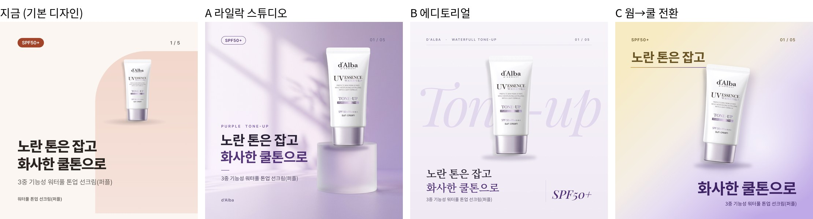

# 퍼플 표지 디자인 방향 3안 (피그마) — 제안

- 상태: **시안·제안** (2026-10-29, 이규동 요청 · Claude). 템플릿·config·cards.json·출력은 안 바꿈. 고른 안을 템플릿으로 옮기는 건 다음 단계
- 피그마: [카드뉴스 피그마 출력 시험](https://www.figma.com/design/6VyvHt5Q6SN6swpeSq3fqp) → `표지 방향 (10.29)` 페이지 (편집 가능한 레이어)
- 앞 단계: [피그마 출력 시험](figma-render-test.md) — 출력 방식은 HTML 유지, 피그마는 디자인·연출 자산 제작에 쓰는 방향으로 정리

문구는 4개 모두 `products/dalba-toneup-purple/cards.json` 1번 그대로(제목·부제·뱃지). 추가한 글자는 패키지에 적힌 영문(`PURPLE TONE-UP`, `WATERFULL TONE-UP`)과 브랜드명뿐.

| 안 | 핵심 | 피그마에서 만든 것 | HTML로 옮길 때 |
|---|---|---|---|
| A 라일락 스튜디오 | 상세페이지형 연출. 빛 그림자가 있는 라일락 무대, 받침 위 제품 | 배경: Figma AI 이미지 생성(제품 없는 빈 무대) / 제품 그림자·받침 그림자 | 배경을 무드 자산 PNG로 내보내고, 글자·제품은 HTML. 받침 위치에 제품을 맞추는 좌표가 배경마다 필요 |
| B 에디토리얼 | 큰 이탤릭 단어(Tone-up) 위에 제품, 세리프 한글 제목, 위 머리줄·가는 선 | 전부 벡터·글자 (생성 이미지 없음) | 그대로 CSS로 가능. 세리프 한글 글꼴(Noto Serif KR 웹 글꼴) 추가 필요 |
| C 웜→쿨 전환 | 제목 내용을 색으로 보여줌. 노란 기 → 라일락 대각선, 제목을 두 줄로 쪼개 위·아래 배치 | 그라데이션·빛 번짐·기울인 제품 | CSS 그라데이션으로 가능. 제목을 두 칸(`title` 줄 단위)으로 나누는 규칙이 필요 |

## 지금 디자인과 다른 점

- 제품이 주인공: 카드 면적 약 13~15% (지금 표지 약 3%)
- 깊이감: 빛·그림자·받침(A), 겹침(B), 색 흐름(C) — 지금은 단색 + 아치 한 개
- 위계: 영문 라벨 → 제목(둘째 줄 강조색) → 가는 선 → 부제. 하단 제품명 반복 제거
- 색: 패키지의 라일락·짙은 보라(#55357A) 기준

## 한계·확인할 것

- 제품 사진 원본이 500px(제품 부분 175×365)이라 1.5배 정도 확대됨. 가까이 보면 살짝 흐림. 공식몰 1000px 사진을 쓰려면 배경 제거·사용 확인 필요 (이전 [퍼플 개선 노트](dalba-purple-redesign/README.md)와 같은 문제)
- 피그마 시안의 한글 글꼴은 Noto Sans KR·Noto Serif KR(피그마에 Pretendard 없음). HTML에서는 Pretendard로 바뀌어 굵기·폭이 조금 다름
- A 배경은 AI 생성 이미지라 무드마다 새로 만들고 사람이 골라야 함(Figma AI 크레딧 사용). 제품을 생성하지 않고 빈 무대만 생성해 실제 제품 사진을 얹음
- 표지 1장만. 고른 방향으로 나머지 4장(특징·설명·사용법·마무리)도 맞춰야 세트가 됨
