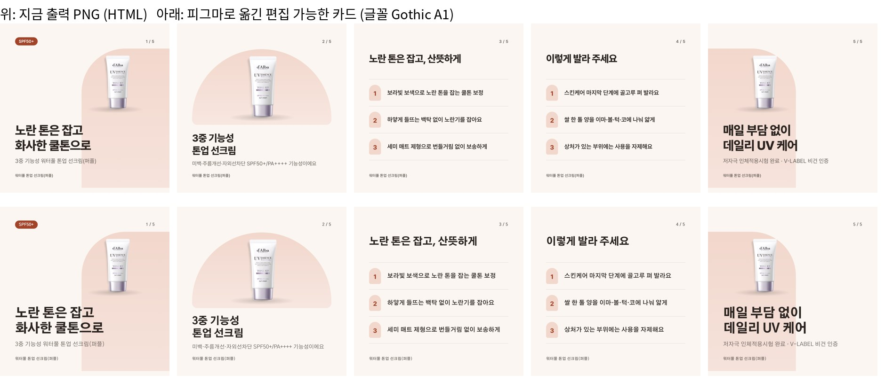

# 출력 카드 → 피그마 (사람이 직접 고치기)

> 2026-11-02 이어서: 웹 작업실 버튼 + 피그마 플러그인으로 연결, 고친 카드를 웹으로 돌려받기 → [figma-plugin.md](figma-plugin.md)

- 상태: **시험 완료·기록** (2026-11-02, 이규동 요청 · Claude). 브랜치 `feat/figma-export` (`feat/claude-design-test` 위). 제작 규칙·템플릿·출력(`npm run render`)은 안 바꿈
- 피그마: [카드뉴스 피그마 출력 시험](https://www.figma.com/design/6VyvHt5Q6SN6swpeSq3fqp) → 페이지 `워터풀 톤업 선크림(퍼플) (dalba-toneup-purple)`, `카모마일 순한 클렌징 오일 (demo-cleansing-oil)`



## 무엇을 하나

`npm run render`로 만든 카드(HTML)를 피그마로 옮겨, 사람이 **글자·사진·도형을 따로 고칠 수 있게** 한다. 그림 한 장으로 붙이는 게 아니라 레이어로 나눈다.

| 카드 요소 | 피그마에서 |
|---|---|
| 글자 | **글자 레이어** (바로 고칠 수 있음). 줄바꿈은 브라우저에서 실제로 바뀐 자리 그대로 넣음 → 피그마의 글자 단위 줄바꿈 문제 없음. 레이어 이름 = 템플릿 칸 이름 (`cover__title (글자)` 등) |
| 단색 상자(모서리·테두리 포함) | **사각형** (색·모서리 고칠 수 있음) |
| 제품 사진, 그라데이션·그림자·`::before/::after` 장식 | 그 요소만 그린 **투명 PNG 레이어** (옮기기·크기·이미지 바꾸기 가능) |

## 순서

```bash
npm run render -- <제품ID>          # 카드 출력 (이미 했으면 생략)
npm run figma-export -- <제품ID>    # output/figma-export/: layers.json, images/*.png, build-*.js
```

그다음 Claude Code(피그마 연결된 상태)가:

1. 피그마 파일에 제품 페이지를 만들고(`use_figma`) 페이지 ID를 받음
2. `upload_assets`(개수 = 이미지 수, 그 페이지)로 받은 주소에 `images/`를 올림 — `bash scripts/figma-upload.sh <images 폴더> <목록> <페이지 ID>` (목록: `파일이름.png 주소ID` 한 줄씩, 5개씩 동시에)
3. `build-1.js` 내용을 그대로 `use_figma`에 넘김 → 1080×1080 프레임 `card-01`~`card-05`가 레이어로 생김 (코드 길이 제한 50,000자 안이면 5장 한 번에)

카드 1장만 다시: `npm run figma-export -- <제품ID> --card 3` → 같은 순서. 같은 이름 프레임은 지우고 다시 만든다.

## 시험 결과

| 제품 (디자인) | 레이어 | 피그마 호출 | 원본과 차이 |
|---|---|---|---|
| 달바 퍼플 (기본) | 글자 25 · 도형 6 · 이미지 14 | 페이지 1 + 업로드 1 + 만들기 1 | 크게 다른 픽셀 3~6% (글꼴만 다름) |
| 클렌징 오일 (프리미엄) | 글자 22 · 도형 7 · 이미지 15 | 같음 | 화면 확인, 배치 같음 |

- 추출이 맞는지는 피그마 없이도 확인: 레이어만으로 HTML을 다시 그려 원본 PNG와 비교하면 차이 0.2~0.6% (Pretendard 그대로일 때)
- 피그마의 차이는 거의 전부 **글꼴**: 이 피그마 환경에 Pretendard가 없어 Gothic A1(400·600·800 굵기가 다 있음)로 바뀜. 글자가 조금 넓어짐. Pretendard가 설치된 피그마 데스크톱에서는 글꼴만 Pretendard로 바꾸면 됨(레이어에 원래 글꼴 이름이 남지는 않음 → 다음 단계 후보)
- 업로드는 Mac에서 `mcp.figma.com`으로 직접 보냄. 이 클라우드 작업 공간은 피그마 주소가 막혀 Mac을 거쳤고, 처음엔 한 장씩 보내다 몇 장이 시간 초과 → 5개씩 동시에 보내도록 바꾼 뒤 15장 모두 2분 안에 성공

## 한계

- `::before/::after`로 그린 번호(1·2·3, STEP 1)는 상자와 함께 이미지가 됨 → 번호 글자는 피그마에서 바로 못 고침
- 그라데이션 배경 카드는 배경 전체가 이미지 한 장(프리미엄 표지) → 색 바꾸기는 이미지 교체로
- 피그마에서 고친 내용은 저장소로 돌아오지 않음. 고친 결과는 피그마에서 PNG로 내보내 쓰는 용도(최종 손질). 문구를 고쳤다면 `cards.json`과 달라지므로 원문 근거 검증은 다시 안 됨 → 문구 수정은 웹 작업실 '수정 요청'으로 하는 게 원칙

## 캔바

- **Claude 디자인 캔버스 → 캔바**: Claude 디자인 내보내기에 'Send to Canva'가 있음(클릭 한 번, 편집 가능하게 넘어감). [Claude 디자인 시험](claude-design-test.md) 캔버스도 가능
- **우리 출력 카드 → 캔바**: 이 세션에는 캔바 연결이 없어 시험 못 함. 피그마로 옮긴 카드를 캔바로 가져오거나(캔바의 피그마 가져오기), 캔바 연결을 추가한 뒤 같은 방식(글자·이미지 레이어)으로 만들 수 있음 — 필요하면 다음 단계
