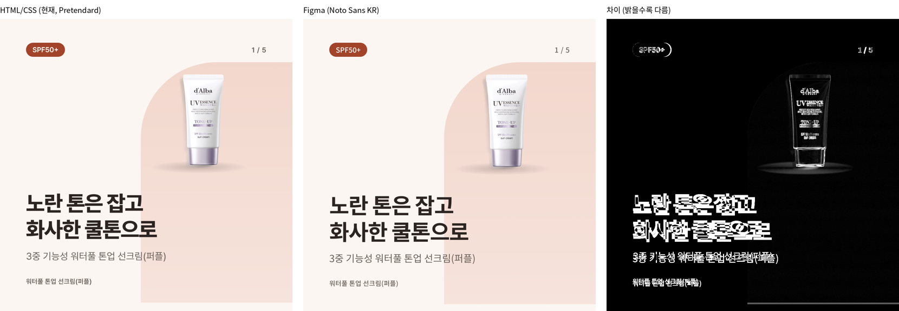
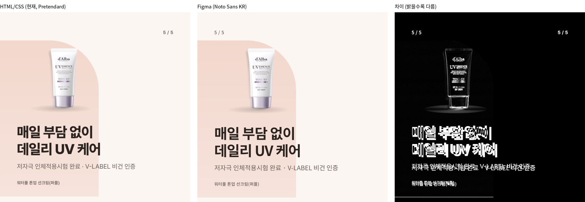
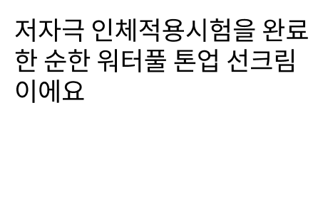
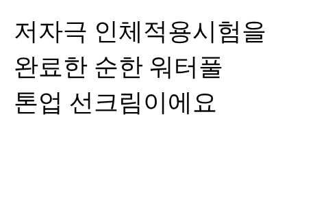

# 피그마 출력 시험 (대안 2) — 1단계: 기본 표지형

- 상태: **시험·기록** (2026-10-29, 이규동 요청 · Claude). 기존 출력(`npm run render`)·템플릿·규칙·규칙 버전은 안 바꿈. 아래는 결정이 아니라 시험 결과
- 브랜치: `feat/figma-render-test` (이슈 미생성 — 이 세션에서 GitHub 이슈·push 권한이 없어 로컬 브랜치로만 만듦)
- 피그마 파일: [카드뉴스 피그마 출력 시험](https://www.figma.com/design/6VyvHt5Q6SN6swpeSq3fqp) (Practice 팀, 학생 플랜 Full 시트) — `템플릿` 페이지(컴포넌트), `출력` 페이지(채운 카드)
- 비교 이미지: [figma-render-test/](figma-render-test/)

## 왜 시험했나

디자인 품질을 올리려고 앞으로 템플릿을 피그마에서 다듬기로 함. 그때 카드 출력 방식이 두 가지:

| | 대안 1: 피그마 → HTML/CSS 옮김 | 대안 2: 피그마에서 직접 채우고 내보냄 |
|---|---|---|
| 출력 | 지금처럼 Playwright로 HTML → PNG | 피그마 컴포넌트 인스턴스에 문구·사진을 넣고 PNG로 내보냄 |
| 장점 | 피그마 없이 로컬에서 돌아감, 호출 제한 없음, 기존 점검(OVERFLOW 등) 그대로 | 디자이너가 본 화면 = 결과물, 템플릿을 한 벌만 관리 |
| 단점 | 피그마 수정마다 HTML로 다시 옮겨야 함 | 피그마 연결·네트워크가 필요, 렌더링 차이(이 문서) |

이번 1단계는 **대안 2가 같은 데이터로 HTML과 같은 결과를 낼 수 있는지**만 본다. 그래서 피그마 템플릿을 새로 디자인하지 않고, 현재 기본 표지형(`templates/cover.html`)을 그대로 옮겼다. 차이가 생기면 그건 출력 방식 차이다.

## 시험 범위

- 제품: `dalba-toneup-purple` (실제 사진, 디자인 기본·카드 색 기본, 최종 승인된 `cards.json` 그대로)
- 카드: 1번(표지, `role=cover`)·5번(마무리, `role=closing`). 2~4번(이미지형·설명형)은 다음 단계
- 기준: 같은 제품을 `npm run render -- dalba-toneup-purple --no-log`로 출력한 PNG

## 만든 것

### 피그마 템플릿 (`템플릿` 페이지)

- 변수 묶음 `card-color` — `color/bg` 등 7개, 값은 `config/theme.json` 그대로 (예전 팀 파일의 `color/*` 이름과 같음)
- 컴포넌트 묶음 `cover (기본)` — 변형 `role=cover`·`role=closing` (아치 방향만 다름)
  - 텍스트 속성: `title`·`subtitle`·`badge`·`page`·`product`, 표시 속성: `showBadge`·`showSubtitle`
  - 레이어 이름 = `cards.json`의 `copy` 필드 이름 (`title`·`subtitle`·`badge`) + `page`·`product`·`image`
  - 카드 전체를 자동 배치(세로)로 짜서 HTML의 flex와 같은 동작: 제목·부제가 짧으면 무대(`stage`)가 커짐
  - 사진은 `stage` 안 `image-slot`(420×(무대 높이-80), 아래 가운데 정렬)을 `image` 레이어가 꽉 채움

### 스크립트 `scripts/figma-spec.js`

`cards.json` → `products/<제품ID>/output/figma/`에 채움 명세(`spec.json`)와 카드별 `use_figma` 코드(`fill-card-NN.js`)를 만든다. 피그마를 직접 부르지 않는다(피그마 MCP는 Claude만 부를 수 있음).

- 검증 통과·`stage`가 `plan`이 아닌 제품만, 지금은 디자인 기본의 cover 카드만 (다른 카드는 '건너뜀'으로 출력)
- 사진 투명 여백 범위는 `render.js`와 같은 `readPixels` 경계를 씀
- 채움 코드가 하는 일: 인스턴스 만들기(같은 이름 이전 출력은 지움 → 카드 1장 재출력 가능) → 텍스트 속성 넣기 → 사진 → 넘침 점검(`title` 196px, `subtitle` 105px — HTML 템플릿 `max-height`와 같음) → `{ instanceId, issues }` 반환
- 테스트: `tests/figma-spec.test.js` (채움 코드 문법·값 그대로 들어가는지, `npm test`에 포함)

### 실행 순서 (Claude가 하는 일)

1. `node scripts/figma-spec.js <제품ID>` → 올릴 사진 목록·`fill-card-NN.js`
2. 사진: 피그마 `upload_assets`로 받은 주소에 **원본 사진**을 `filename=<upload_name>.png`로 POST (레이어 이름 = `upload_name`). 제품마다 한 번
3. 카드마다 `use_figma`에 `fill-card-NN.js` 내용을 그대로 넘김
4. 카드마다 `get_screenshot`(최대 1080px) → PNG 저장

호출 수(카드 5장 기준 예상): 사진 업로드 1 + 채우기 5 + 내보내기 5 = **피그마 호출 약 11번**. 이번 시험의 채우기 한 번은 몇 초 안에 끝남.

## 결과




| 항목 | 결과 |
|---|---|
| 배치 | 뱃지·페이지·아치·받침 그림자·제품 사진 위치가 거의 같음. 무대 높이 HTML 429px / 피그마 435px (글꼴 줄 높이 차이로 글자 묶음이 6px 낮아짐) |
| 사진 | 원본을 올리고 투명 여백만 잘라 보여주는 방식으로 HTML(`object-view-box`)과 같은 크기·위치. 피그마 쪽이 약간 더 선명함 |
| 넘침 점검 | 두 장 모두 `issues: []` (HTML 레이아웃 점검도 오류 0) |
| 픽셀 차이 | 색 차이가 큰 픽셀 약 6% (대부분 글자 모양, 위 비교 이미지 셋째 칸) |

### 발견한 제약 (대안 2를 계속하려면 정해야 할 것)

1. **글꼴: Pretendard가 없음.** 이 피그마 환경(MCP로 실행)에서 쓸 수 있는 한글 글꼴은 Google Fonts 계열뿐이었다(Noto Sans KR, Gothic A1, IBM Plex Sans KR, 나눔고딕 등). 그래서 Noto Sans KR로 그렸고 굵기도 맞는 게 없어 800→Bold(700), 600→Medium(500)으로 대신함. 팀 글꼴 올리기는 Organization 이상 플랜 기능이라 지금 학생(Professional) 플랜으로는 안 됨. → **피그마와 HTML이 같은 글꼴을 쓰려면 프로젝트 글꼴을 두 쪽에 다 있는 글꼴로 바꾸는 결정이 필요** (예: Gothic A1은 400·600·800 굵기가 다 있음)
2. **한글 줄바꿈.** 피그마는 한글을 글자 단위로 줄바꿈한다("완료|한", "선크림|이에요"). HTML은 `word-break: keep-all` + `text-wrap: balance`로 단어 단위. 이번 표지는 제목에 직접 줄바꿈(`\n`)이 있어 문제가 안 드러났지만 부제·설명형 항목처럼 자동 줄바꿈되는 칸은 문제가 된다. → 브라우저로 줄바꿈 위치를 먼저 정해 `\n`을 넣어 보내는 방식을 다음 단계에서 시험할 수 있음

   | 피그마 | HTML |
   |---|---|
   |  |  |

3. **인스턴스는 레이어 크기·위치를 못 바꿈.** 플러그인 API에서 인스턴스 안 레이어의 크기·위치 변경이 막혀 있다(`cannot be overridden in an instance`). 그래서 템플릿을 자동 배치 칸 + 꽉 채우는 레이어로 짜고, 사진은 '어느 범위를 보여줄지'(CROP 창)로 HTML의 `contain + center bottom`을 흉내 냄. 제품 둘레의 투명 여백이 모자라면 위치가 달라질 수 있어 `IMAGE_FIT`으로 알림. 새 템플릿도 이 규칙(크기가 바뀌는 건 자동 배치로)으로 그려야 함
4. **네트워크.** 사진 올리기는 `mcp.figma.com`에 직접 POST해야 한다. 이번 클라우드 작업 공간은 피그마 주소가 막혀 있어 이규동 Mac에서 올렸다. 로컬 Claude Code로 돌릴 때는 문제없을 것으로 봄(미확인)
5. **점검 범위.** HTML 출력의 레이아웃 점검(글자 칸 겹침, 사진·글자 겹침, 대비 등)은 아직 피그마 쪽에 없다. 넘침(OVERFLOW)만 같은 기준으로 옮김

## 판단 (이번 단계까지)

- **배치·사진은 대안 2로 HTML과 같은 결과를 낼 수 있다.** 템플릿을 자동 배치 규칙대로 그리면 문구 길이에 따라 HTML과 같이 움직였다.
- **그대로 쓰면 글꼴·한글 줄바꿈 때문에 지금 결과보다 나빠진다.** 디자인 품질을 올리려는 목적이라면 1·2번을 먼저 풀어야 한다.
- 다음 단계 후보 (하나씩):
  1. 프로젝트 글꼴 결정 (Pretendard 유지 → 대안 1 쪽이 유리 / 두 쪽 공통 글꼴로 바꿈 → 대안 2 가능)
  2. 줄바꿈 미리 정하기 시험 (부제를 일부러 길게 한 경우)
  3. 이미지형·설명형 템플릿 옮기기 → 5장 한 세트 비교, 시간·호출 수 재기

## 다시 해보는 법

```bash
CHROMIUM_PATH=<크로미움 경로(선택)> node scripts/figma-spec.js dalba-toneup-purple
npm run render -- dalba-toneup-purple --no-log   # 비교 기준
```

그다음 위 '실행 순서' 2~4를 Claude Code에 맡긴다. 피그마 출력 PNG는 `products/<제품ID>/output/figma/png/`에 두며 `output/`은 git에 올라가지 않는다.
